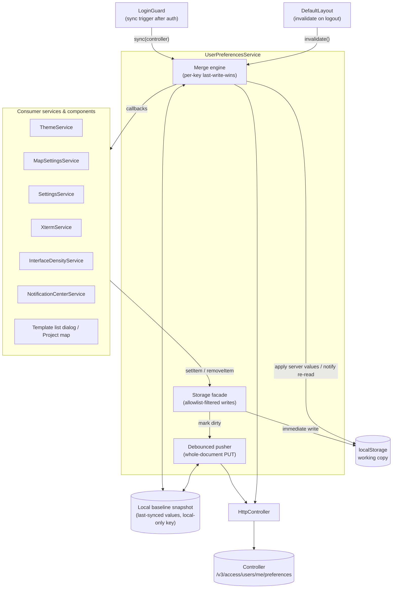
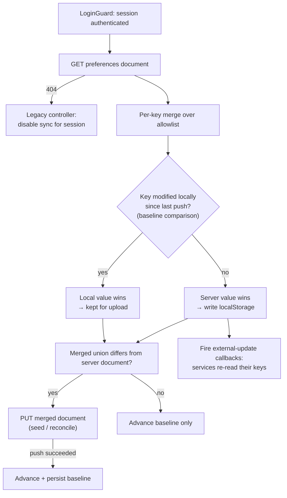
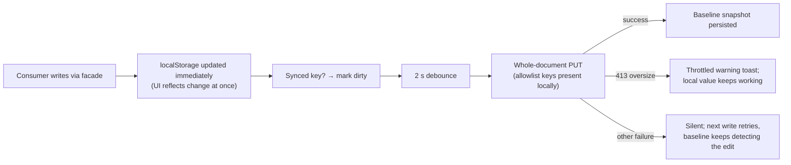

# User Preferences Sync

User-scoped UI preferences are mirrored between localStorage (the working copy) and a per-user preferences document on the controller (`GET`/`PUT /v3/access/users/me/preferences`), so a user's settings follow them across browsers and machines. The endpoint requires only an authenticated session — no additional privilege.

## Architecture Overview

Key responsibilities:

- **UserPreferencesService** — the only component that talks to the endpoint. Acts as a localStorage-compatible facade for consumers, decides what is synced (allowlist), merges the server document on login, and pushes with a debounce. It is a construction-time DI leaf (constructor injects only `Injector`; `HttpController`/`ToasterService` are resolved lazily) because constructor-injecting them would close an instantiation cycle through `NotificationCenterService`.
- **localStorage** — the working copy. Reads are always synchronous and local; the app renders with correct preferences before any server round-trip and keeps working when the controller is unreachable.
- **Local baseline snapshot** — a local-only key recording the value of every synced key as of the last successful push. It is the input for local-edit detection and is deliberately excluded from the allowlist.

## Flow Description

Login-time merge (once per controller per session):

Write flow (user changes a setting):

## Implementation Logic

**Allowlist as the boundary.** `SYNCED_PREFERENCE_KEYS` is the single decision point for what leaves the browser. It is both the security boundary (session tokens, the controller registry, remember-me data, notification history and window geometry are never synced) and the size boundary. Values are stored as the exact localStorage strings, so the sync layer needs no per-setting schema and each consumer keeps its existing parsing.

**Document shape.** The server document is `{"version": 1, "webui": {key: value}}`. The whole document is replaced on PUT (server semantics), while merging is done per key on the client.

**Per-key last-write-wins with a baseline.** The server applies whole-document last-write-wins; the client narrows that to per-key resolution by remembering, for each key, the value it last pushed (or merged). A key whose local value differs from that baseline is "locally edited" and beats the server on the next merge; otherwise the server value wins and is applied locally. The baseline advances only on a successful push, so a failed push keeps the edit detectable. The baseline is persisted locally, which extends this protection to edits made in a previous session (e.g. changed while offline, browser closed before a retry).

**Degradation ladder.** A 404 on the first GET (controller predates the endpoint) disables syncing for the session and the facade degrades to plain localStorage. A document exceeding the 256 KiB server cap is rejected locally with a throttled warning toast. All other failures are silent: localStorage remains authoritative, writes retry on the next change and the next login re-fetches.

**Account isolation on shared browsers.** Logout clears the local mirror of all synced keys and the baseline, then fires the external-update callbacks so cached service fields fall back to defaults. The next login rebuilds the mirror purely from that user's server document — a different user on the same browser neither inherits the previous user's values nor seeds them into their own document. Because logging in requires a reachable controller, this clearing has no offline cost. The theme deliberately stays visually unchanged across logout until the next merge.

**Synced keys by configuration surface.**

| Surface | Keys |
|---|---|
| Settings → Appearance | `theme`, `mapTheme`, `gns3_interface_density` |
| Settings → Project workspace | `openReadme`, `openConsolesInWidget`, `defaultShowGrid`, `defaultSnapToGrid`, `defaultSceneWidth`, `defaultSceneHeight`, `defaultGridSize`, `defaultDrawingGridSize`, `defaultLabelStyle`, `defaultNoteStyle`, `defaultLinkStyle` |
| Settings → Console | `console_command` |
| Settings → Privacy | `crash_reports`, `statistics_command` |
| Workspace console window settings panel | `gns3_console_appearance` |
| Project map toggles | `layersVisibility`, `gridVisibility`, `symbolScaling`, `showInterfaceLabels`, `integrateLinkLabelsToLinks`, `consoleContextMenu` |
| Add-nodes dialog | `addNodesViewMode` |
| Notification center | `notificationsVisibility` |

**Explicitly not synced.** Per-project data (e.g. per-link rendering style — persisted by the controller in each link's `link_style` and written to the `.gns3` topology file, not mirrored in localStorage), anything security- or session-scoped, transient caches, and screen-size-dependent window geometry. BPF presets are a planned second phase.
